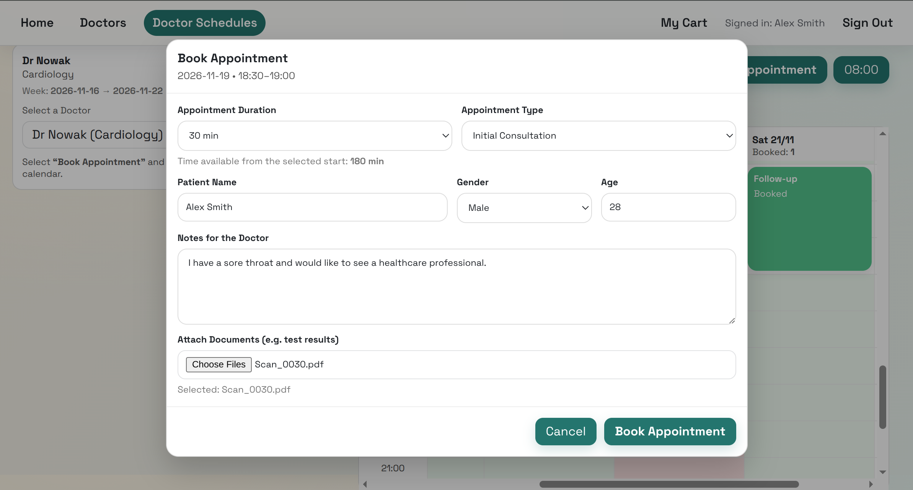
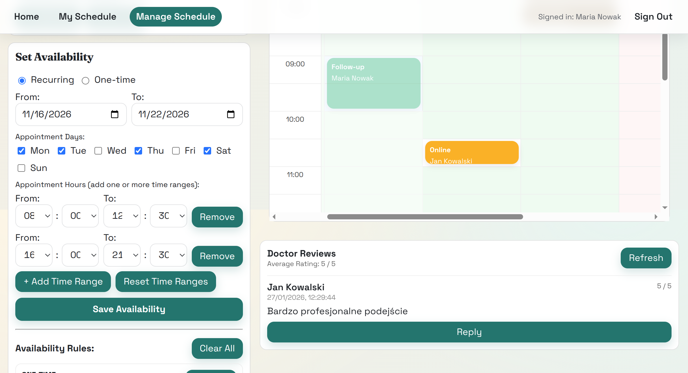
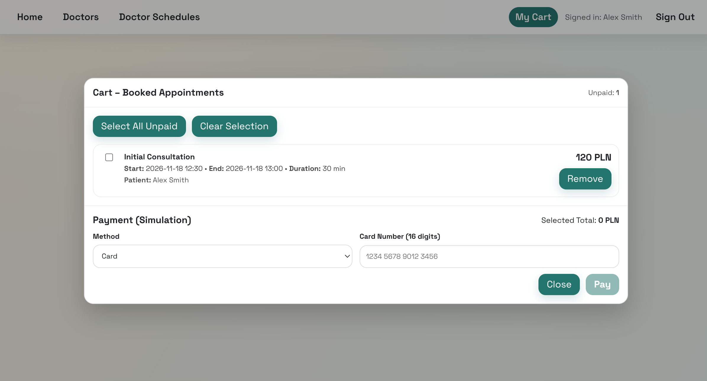
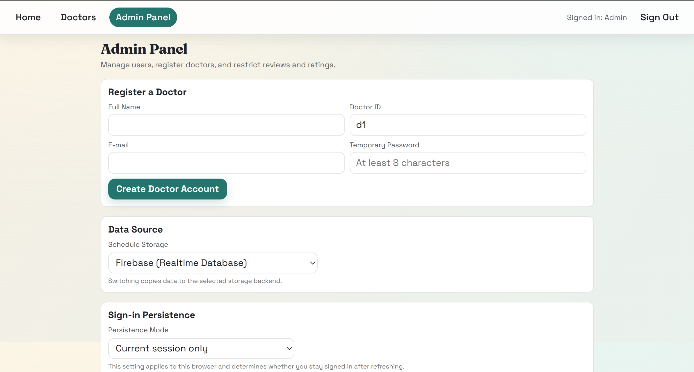

# Doctor Appointment Scheduler

## Overview

A React and TypeScript application for medical appointment scheduling. Patients can find doctors and book appointments, doctors can manage availability, and administrators can manage accounts and moderate reviews.

## Features

| Role | Implemented features |
| --- | --- |
| Patient | Email/password registration, doctor directory, weekly schedules, booking and cancellation, appointment cart, simulated card/BLIK payments, doctor announcements, ratings and reviews after completed appointments |
| Doctor | Assigned schedule, recurring and one-time availability, all-day absences with automatic cancellation of conflicting bookings, announcements, replies to reviews |
| Administrator | User list, doctor registration, review restrictions, review deletion, schedule storage migration, browser sign-in persistence |

Appointments use consecutive 30-minute slots. Supported types include initial consultations, follow-ups, chronic care, prescriptions, online consultations, and document reviews. Booking saves patient age and gender; cancellations retain their reason and release the slot.

## Tech Stack

- **Frontend:** React 19, TypeScript, Vite, CSS.
- **Backend:** Node.js, Express, TypeScript, Firebase Admin SDK.
- **Authentication and database:** Firebase Authentication and Realtime Database.
- **Alternative schedule storage:** JSON files and localStorage, with IndexedDB for file handles.
- **Tests:** Node.js test runner and Firebase Auth/Database emulators.

## Screenshots

### Weekly calendar

Browse a doctor's schedule, available times, booked appointments, and absences.


<details>
<summary>Appointment booking</summary>

Choose an appointment type and duration, enter patient details, and add notes for the doctor.



</details>

<details>
<summary>Doctor schedule management</summary>

Set recurring or one-time availability and manage appointment hours alongside the calendar.



</details>

<details>
<summary>Appointment cart and simulated payment</summary>

Review booked appointments and select unpaid visits for a simulated payment.



</details>

<details>
<summary>Administrator panel</summary>

Register doctor accounts and configure schedule storage and sign-in persistence.



</details>

## Getting Started

### 1. Prerequisites and dependencies

Use Node.js 22 (22.12 or newer) and npm. The project includes `.nvmrc`. Java 21 is required only for the database emulator tests.

From the repository root:

```bash
nvm use # if you use nvm
npm ci
npm ci --prefix server
```

All remaining commands assume the repository root unless noted otherwise.

### 2. Configure Firebase and the frontend

1. Create a Firebase project, register a web app, enable Email/Password authentication, and create a Realtime Database.
2. Add your development hostname, such as `localhost`, to Authentication’s authorized domains.
3. Copy the frontend environment template:

   ```bash
   cp .env.example .env.local
   ```

4. Fill in the `VITE_FIREBASE_*` values with the web app configuration from Firebase. These are public client configuration values; never put a service account key in a `VITE_*` variable.
5. Apply `firebase.database.rules.json` in the Firebase console.
6. In a **new development database**, import `public/data/consultations-db.json` under the `consultationsDb` node. Do not import at the root or overwrite existing user data. The client does not automatically seed a live database.

The doctor directory comes from `public/data/calendar.json`. Keep its doctor IDs consistent with the database and doctor accounts; the examples use `d1` and `d2`.

Without frontend configuration, the application displays a setup message. Restart Vite after changing environment variables.

### 3. Configure the backend

```bash
cd server
cp .env.example .env
```

Set these values in `server/.env`:

| Variable | Purpose |
| --- | --- |
| `PORT` | API port; defaults to `3333` |
| `FIREBASE_DATABASE_URL` | Realtime Database URL for the same project as the frontend |
| `FIREBASE_SERVICE_ACCOUNT_PATH` | Absolute path to a service account JSON file stored outside the repository |
| `FIREBASE_SERVICE_ACCOUNT_JSON` | Alternative single-line credential JSON; configure only one credential option |
| `ADMIN_EMAILS` | Comma-separated allowlist for administrator setup |
| `ALLOWED_ORIGINS` | Allowed frontend origins for direct cross-origin API access |
| `SCHEDULE_TIME_ZONE` | Clinic IANA time zone; defaults to `Europe/Warsaw` |

Local environment files and common service-account filenames are ignored. Keep credentials outside the repository regardless of filename; check staged files before publishing.

### 4. Start both services

Backend, from `server/`:

```bash
npm run dev
```

Frontend, in a second terminal from the repository root:

```bash
npm run dev
```

Open the address printed by Vite, normally `http://localhost:5173`. The backend normally listens on `http://localhost:3333`; `/health` reports process availability, not Firebase connectivity.

The frontend defaults to `/api`. Vite proxies requests to port 3333 and removes the `/api` prefix. For a different API address, set `VITE_AUTH_SERVER_URL=http://localhost:3333` in `.env.local` and restart Vite. Use no trailing slash and add the frontend origin to `ALLOWED_ORIGINS`.

### 5. Create an administrator and doctor accounts

Register your intended administrator email in the application, include it in `ADMIN_EMAILS`, and run this trusted local command from `server/`:

```bash
npm run admin -- admin@example.com
```

This command uses server credentials to grant administrator access to an existing Firebase Authentication account. Sign out and sign in again afterward. It deliberately changes that account’s role; do not run it for an unrelated account.

The administrator can create doctors linked to existing doctor IDs. Sign in as a doctor to add future availability, then use a separate patient account to book a slot. The bundled sample schedule covers November 16–22, 2026; navigate to that week to view it.

## Verification

From the repository root:

```bash
npm run lint
npm run build
npm test
npm run test:integration
```

- `npm run build` checks frontend TypeScript and creates `dist/`.
- `npm test` builds the backend and runs scheduling, validation, privacy, and permission tests.
- `npm run test:integration` starts disposable Auth and Realtime Database emulators, then tests the actual API, database rules, simultaneous bookings, and booking/absence races. No live Firebase project or service account is needed. The first run downloads the emulator.
- `npm run build --prefix server` builds the backend independently; `npm start --prefix server` runs the compiled server.

The GitHub Actions workflow in `.github/workflows/ci.yml` runs these checks from the repository root on pushes and pull requests.

## Project Structure

```text
doctor-appointment-scheduler/
├── .github/workflows/     # Automated build, lint, and test checks
├── src/
│   ├── components/        # Calendar, appointment forms, cart, reviews
│   ├── views/             # Role-specific pages and authentication screens
│   ├── auth/              # Firebase sign-in and authorization profile context
│   ├── lib/               # Scheduling helpers, API client, storage services
│   └── firebaseConfig.ts  # Reads frontend environment configuration
├── server/
│   ├── src/index.ts       # Authorization, schedules, users, review API
│   ├── src/schedule.ts    # Pure validation/actions, also used by JSON mode
│   ├── test/              # Scheduling and privacy regression tests
│   └── scripts/           # Trusted administrator setup
├── tests/                 # Emulator-backed API and database rule tests
├── public/data/           # Doctor directory and sample schedule data
├── firebase.database.rules.json
├── firebase.json          # Local emulator configuration
└── IMPROVEMENT_PLAN.md
```

## Data Storage and Authorization

Firebase is the default schedule backend. Data remains under `consultationsDb`, profiles under `users/{uid}`, and reviews under `comments/{doctorId}`.

The Express API verifies Firebase ID tokens, reads trusted role profiles, and filters schedule responses. Patients see other bookings as occupied slots without names, notes, documents, or consultation types. Doctors see patient details only for their assigned schedule. Direct client writes to profiles and schedule data are denied; only a user’s own profile and the non-sensitive schedule revision are readable directly. Revision changes trigger a fresh filtered API response.

Schedule actions use database transactions: checking availability, detecting overlaps, and committing a booking happen together. Absences and their cancellation overrides/notifications are also committed together. Input validation and save errors are surfaced to the user.

New accounts normally receive `PATIENT` access. An allowlisted email can receive administrator access during initial profile creation only when its Firebase email claim is verified. Existing profiles are not automatically promoted; the trusted setup command above handles them. Doctor accounts are created by an administrator. Review restrictions do not prevent signing in.

### JSON/localStorage alternative

The admin storage selector copies schedule data to the selected backend and remembers the selection in the current browser. Switching to Firebase is an administrator-only replacement import, so use it deliberately and back up existing data first.

JSON reads prefer a previously selected file, then localStorage, then the bundled template. Writes use the File System Access API when available, otherwise localStorage. File handles are stored in IndexedDB, and local edits are serialized with Web Locks where supported.

Local mode uses the same scheduling validation but is a single-browser demonstration, not a secure shared database. Authentication, roles, and reviews still require Firebase and the API. Review eligibility is checked against Firebase appointments, so local-only bookings do not establish eligibility.

## Notes and Limitations

- Payments are simulated and priced in PLN. Do not enter real payment details.
- Document selection saves filenames only; file contents are not uploaded.
- Files in `public/data/` are publicly served demo fixtures; never put real patient information in them.
- The calendar uses browser-local civil time. For connected booking, availability, and absence edits, the browser’s IANA time zone must match `SCHEDULE_TIME_ZONE`. Mismatches are rejected instead of silently booking against a different zone.
- Cancellation notification records are stored; doctor announcements appear on schedules. There is no dedicated notification inbox or email delivery.
- Stored user content retains its original language.
- Transactions currently cover the schedule branch. This favors correctness for a small educational app over large-scale throughput.
- Dependency patches are included, but remaining upstream audit findings require review; see `docs/VERIFICATION.md`. Avoid blindly running `npm audit fix --force`.
- This is a portfolio/educational application, not a production medical platform.

**Before deploying:** release the matching API and Firebase rules together. Older clients that write directly to Firebase will stop working with these rules. Back up existing data and audit existing role profiles, especially if the earlier permissive rules were deployed. No live rules, profiles, or records are changed by editing this repository.

Vite’s proxy is development-only. A production static host needs equivalent `/api` routing or a build-time API URL, and appropriate SPA fallback routing.

## Future Improvements

- Add a patient notification inbox and optional reminders.
- Implement secure document uploads and retention controls.
- Support a clinic time zone independently of the browser’s time zone.
- Add browser-based workflow tests and a documented demo deployment.
