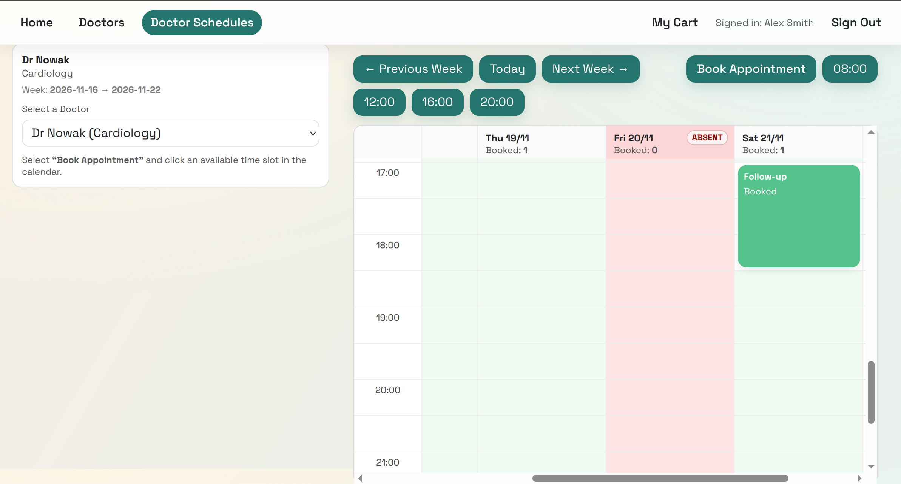

# Doctor Appointment Scheduler

A medical appointment scheduling application built with React, TypeScript, Express, and Firebase. Patients can book appointments, doctors can manage availability, and administrators can manage accounts.

- **Patients:** doctor directory, appointment booking and cancellation, reviews, and simulated payments.
- **Doctors:** weekly schedules, recurring and one-time availability, absences, announcements, and replies to reviews.
- **Administrators:** doctor registration, user management, and review moderation.

See the [project documentation](miniprojekt/doctor-calendar/README.md) for setup instructions, architecture, tests, and limitations, or browse the [screenshots](miniprojekt/doctor-calendar/README.md#screenshots).

Application source lives in `miniprojekt/doctor-calendar/`. GitHub Actions configuration lives in `.github/workflows/`.

This is an educational portfolio project. Payments are simulated, and connected services require Firebase configuration.
